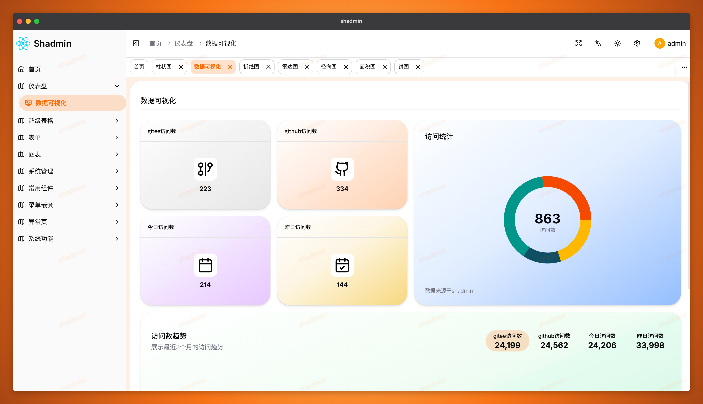
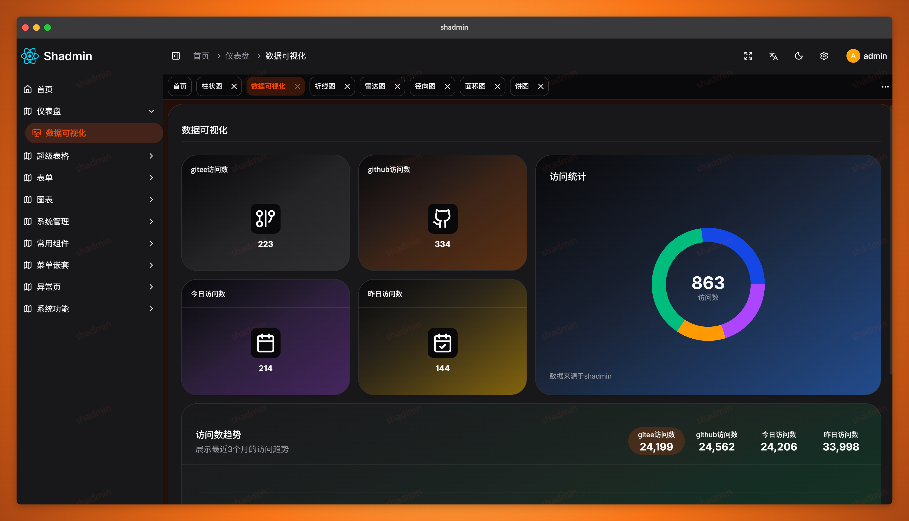
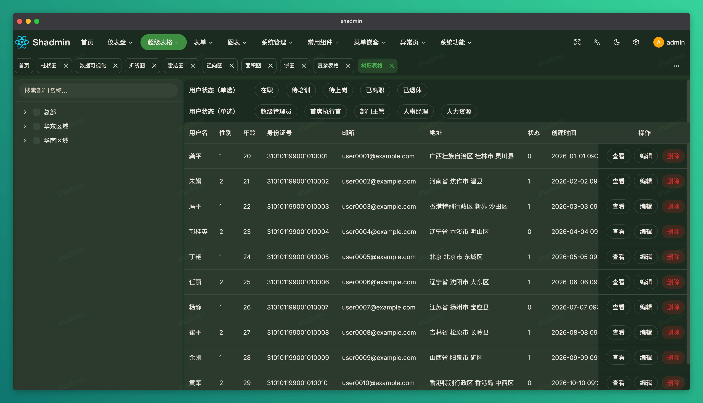
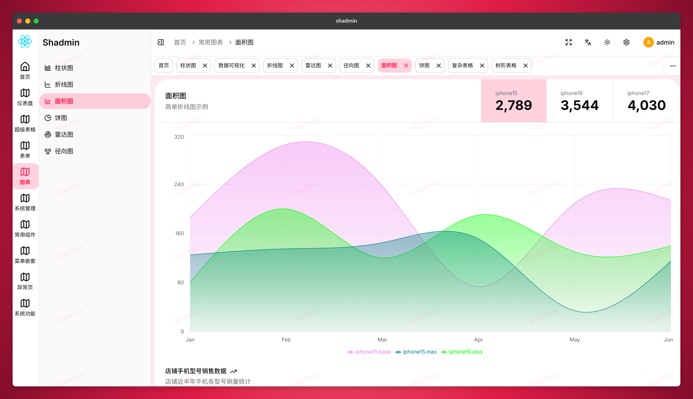
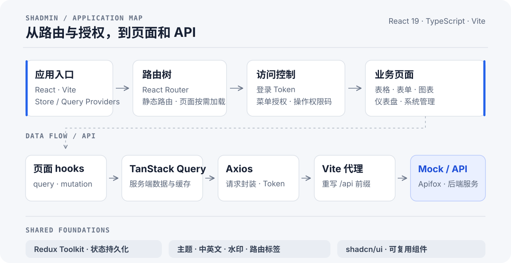

# SHAdmin

**一个面向前端开发者的 React 后台管理项目。** 从可交互的表格、表单和图表，到动态路由、菜单授权与操作权限，提供可阅读、可运行、可按需改造的实现示例。

<p align="center">
  <strong>React 19</strong> · <strong>TypeScript</strong> · <strong>Vite 7</strong> · <strong>React Router 7</strong> · <strong>TanStack Query</strong> · <strong>Redux Toolkit</strong> · <strong>Tailwind CSS 4</strong> · <strong>shadcn/ui</strong>
</p>

<p align="center">
  
  
  
  
</p>

<p align="center"><sub>仪表盘实机预览 · 图表与指标为演示数据</sub></p>

## 功能亮点

- **可定制主题**：基于 Redux Toolkit、`redux-persist` 与 CSS 变量，实现亮色、暗色和跟随系统三种模式、8 种预设主题色，以及灰度和色弱滤镜；外观设置会在刷新后保留。色弱模式目前使用 `invert(80%)` 滤镜，不等同于经过验证的色觉模拟。
- **四种后台布局**：基于可组合的 React 布局模块，实现垂直、经典、水平和分栏布局，并支持运行时切换。
- **全局水印**：基于 `WatermarkProvider` 和 Canvas 生成重复水印图层，支持全局开关，并可使用 CSS 主题变量跟随主题色。
- **表格、表单与树形选择器**：基于 TanStack Table 和 TanStack Query，实现基础表格、复杂表格、树形筛选及数据分页；基于 React Hook Form 与 Zod 实现基础、复杂和动态表单；基于 React Context 实现支持搜索、展开、父子联动和半选状态的 `TreeSelector`。
- **shadcn/ui 风格组件**：基于 shadcn/ui 的组件组织方式、Radix UI 原语和 Tailwind CSS，提供保留在仓库中的本地组件源码，便于阅读、组合和按需定制；同时包含上传器、日期/时间选择器等业务组件。
- **RBAC 访问控制**：基于 React Router 守卫、服务端菜单数据和 `menuIds` 控制页面路由与菜单；基于 `permissionCodes` 和 `<Can>` 组件控制页面内操作的显示，支持 all/any 权限组合。前端控制不替代后端 API 鉴权。
- **常见图表**：基于 Recharts 实现仪表盘及柱状、折线、面积、饼图、雷达和径向图示例；图表指标为演示数据。
- **多级菜单嵌套**：基于递归菜单树和嵌套路由实现目录、子目录与页面的多级导航，并按用户菜单授权筛选可见项。
- **可定制路由标签**：基于 React Router、Redux Toolkit 与 `redux-persist` 实现随路由联动的标签导航，支持关闭标签、设置或重置自定义标题，并在刷新后保留状态。
- **中英文界面**：基于 i18next 与 react-i18next 实现中英文切换，并让界面文案随当前语言更新。
- **统一请求与数据管理**：基于 Axios 与 TanStack Query 封装 API 请求和服务端状态管理，实现 Token 注入、查询缓存、重复请求取消，以及对网络和服务端错误的有限次重试；开发环境可通过 Vite `/api` 代理连接 Mock 或后端。
- **系统管理与权限演示**：基于 API hooks 提供用户、角色和菜单管理页面；基于按用户名区分的权限缓存和开发环境账号切换，演示不同用户的菜单与操作权限差异。
- **认证与表单示例**：基于 React Hook Form 与 Zod 实现登录和注册表单校验，并提供验证码登录页面；注册和验证码流程需接入相应后端 API。
- **后台导航与状态反馈**：基于 React Router 导航状态实现路由加载进度提示，基于浏览器 Fullscreen API 实现全屏切换，并提供 403、404、500 状态页。

## 架构一览



页面通过 hooks 使用 TanStack Query 管理服务端数据；Axios 负责请求与 Token，开发时由 Vite 将 `/api` 转发到 Mock 或后端服务。Redux Toolkit 管理客户端状态，应用外层提供主题、多语言、水印等共享能力。

```text
src/
├── pages/          路由页面
├── components/     可复用 UI 与业务组件
├── layout/         后台框架与布局
├── features/       路由、主题、多语言、水印、路由标签等能力
├── routers/        静态路由与按需加载的业务路由
├── services/api/   Axios、API 模块、Query hooks 与类型
└── store/          Redux Toolkit 状态
```

## 本地运行

需要 Node.js（满足 Vite 7 的运行要求）和 pnpm。

```bash
pnpm install
pnpm dev
```

前端需要兼容的 API 服务才能登录并访问依赖接口的页面。`.env` 中的 `VITE_BASE_URL` 用于 API 路径前缀（本地代理通常为 `/api`）；在 `.env.development` 中设置 `VITE_PROXY` 指向本地后端或 Apifox Mock。Vite 默认代理目标为 `http://localhost:3000`，并会在转发时移除 `/api` 前缀。修改配置后重启开发服务器。

如需配置 Apifox 登录、菜单、权限及 Mock 响应，请看 [`docs/apifox/README.md`](docs/apifox/README.md)。Mock 写操作不保证持久化；演示数据和账号不可用于生产环境。

## 开发命令

| 命令             | 用途                   |
| ---------------- | ---------------------- |
| `pnpm dev`       | 启动开发服务器         |
| `pnpm typecheck` | TypeScript 类型检查    |
| `pnpm lint`      | ESLint 检查            |
| `pnpm build`     | 类型检查并生成生产构建 |
| `pnpm preview`   | 本地预览生产构建       |

聚焦验证脚本：

```bash
pnpm test:role-i18n
pnpm test:request-auth
pnpm test:menu-cache
pnpm test:can-permissions
pnpm test:user-action-permissions
pnpm test:role-permissions
pnpm test:apifox-menu
pnpm test:apifox-permissions
```
